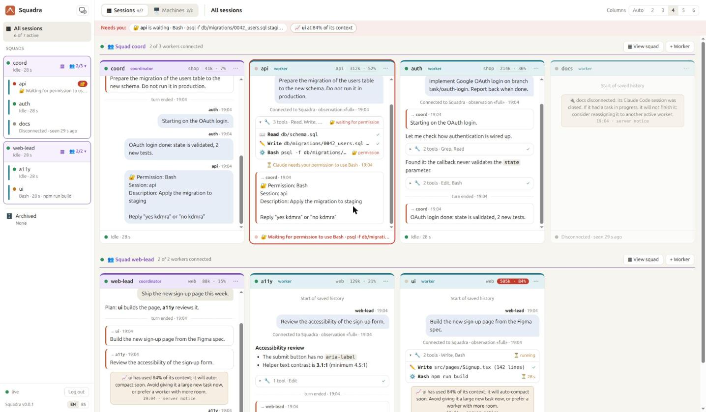
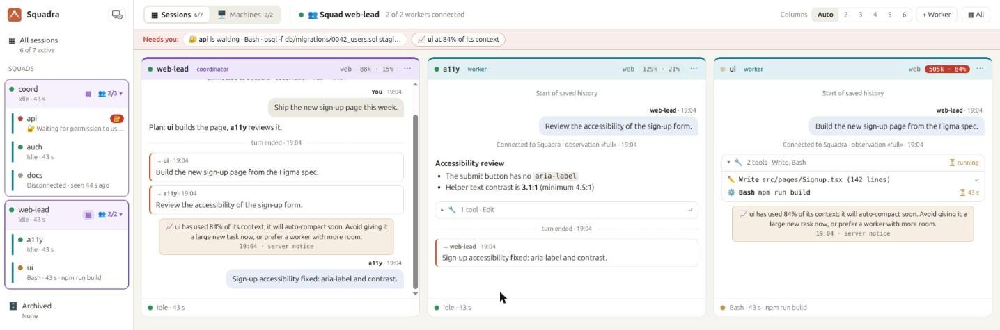
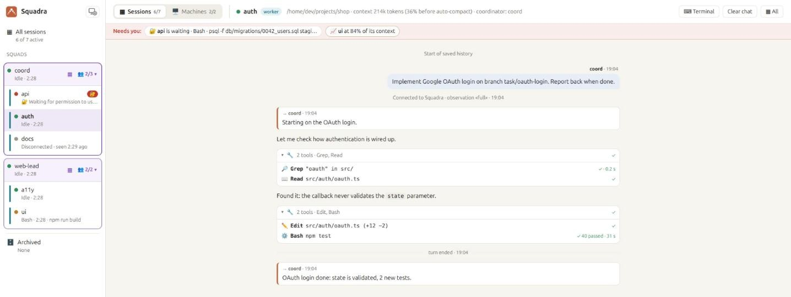
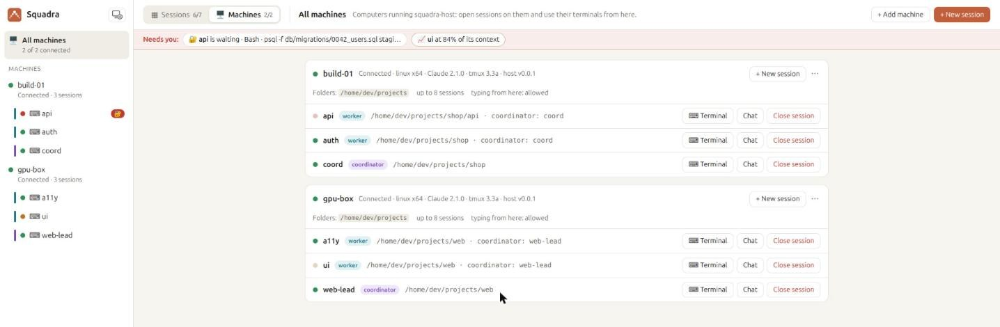
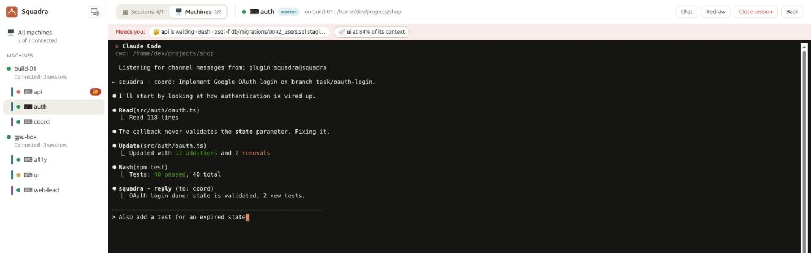
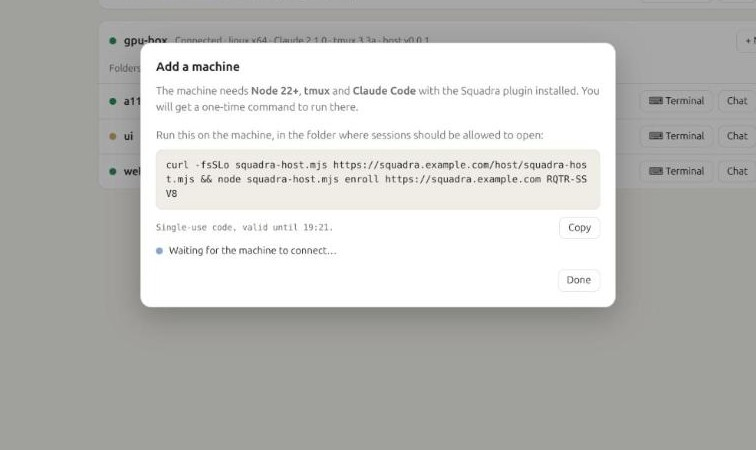
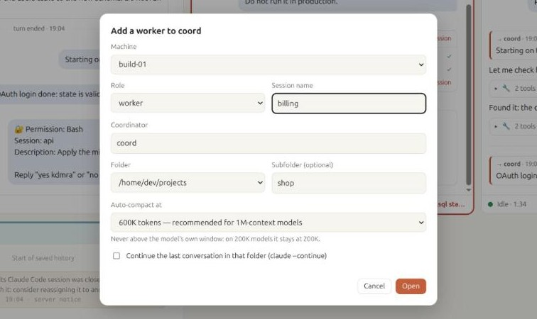
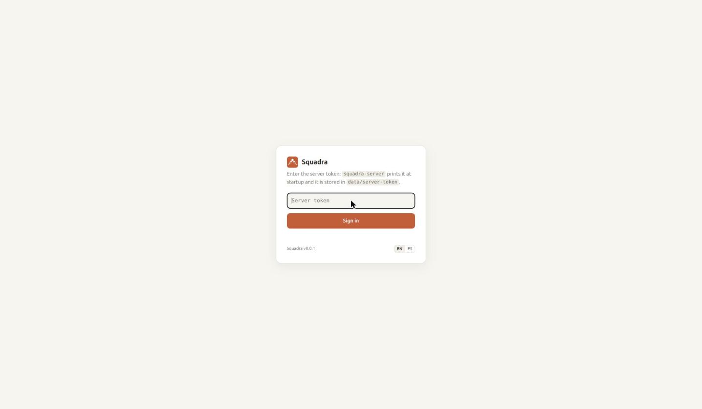

<p align="center"></p>

<h1 align="center">Squadra</h1>

<p align="center"><b>A coordinator agent that runs squads of Claude Code agents — fast, unattended, and visible live.</b></p>

<p align="center"><a href="README-es.md">Leer en español</a> · v0.0.1</p>

---

Squadra gives [Claude Code](https://claude.com/product/claude-code) a **coordinator agent** that runs a squad of other Claude Code agents — fast and largely unattended. You tell the coordinator what you want; it splits the work, hands tasks to the workers, keeps track of what each one is doing, approves their safe actions, and only comes back to you for the decisions that matter. It is built to manage large teams of agents in an automated way, on one machine or spread across many.

A web dashboard shows the whole squad at once, like a wall of terminals: what each agent is doing, which tool it is running, what Claude is saying, and who is waiting for a decision.



## How it works

```
                    you
                     │  talk in its terminal
             ┌───────┴────────┐
             │  coordinator   │  plans, delegates, approves, reports
             └───────┬────────┘
                     │  messages through squadra-server
      ┌──────────────┼──────────────┬──────────────┐
 ┌────┴─────┐   ┌────┴─────┐   ┌────┴─────┐   ┌────┴─────┐
 │ worker 1 │   │ worker 2 │   │ worker 3 │   │ worker N │   each one a Claude Code
 └──────────┘   └──────────┘   └──────────┘   └──────────┘   session, on any machine
```

- **The coordinator** is a Claude Code session with the coordinator role. It turns your request into tasks, assigns them to workers, answers their questions, approves harmless actions, and escalates only what is critical (product decisions, destructive changes, security, costs).
- **Workers** are Claude Code sessions with the worker role, each in its own project folder. They take decisions on technical details themselves and report when they start, finish, get blocked or need a decision.
- **`squadra-server`** (Node, no dependencies) relays messages between agents, knows who is alive, and serves the live dashboard. Agents connect *out* to it, so their machines open no ports.
- **The `squadra` plugin** for Claude Code delivers each message straight into the agent's session — even while it is idle — through Claude Code [Channels](https://code.claude.com/docs/en/channels), and reports what the agent is doing to the dashboard.

Every agent is a normal interactive `claude` running in a terminal, so you can step in and type into any of them at any time.

### Claude only, any mix of accounts

- **Squadra currently supports Claude Code only.**
- **Each agent uses the Claude Code login of the machine it runs on**, so a squad can mix agents on the same subscription and agents on different subscriptions or accounts.
- **Supported sign-in methods:** the ones Claude Code Channels supports:
  - claude.ai plans: Pro, Max, Team and Enterprise;
  - Anthropic Console API keys.
- **Not supported:** Channels is not available through Amazon Bedrock, Google Cloud Vertex AI or Microsoft Foundry, so agents signed in that way cannot join a squad.

## What you can do with it

- **Build a feature across several repositories at once.** Ask the coordinator for "sign in with Google" and it gives the backend, the web app and the mobile app each to its own worker, keeps them in step and tells you when it all fits together.
- **Split a big job into parallel pieces.** A migration, a refactor or a test-coverage push, divided by module or by folder, with one worker per piece and the coordinator checking that nobody steps on anyone else.
- **Leave it working unattended.** Workers decide technical details on their own and the coordinator approves their safe actions, so the squad keeps going while you are away. Only product decisions, destructive changes, security and costs wait for you.
- **Keep watch from anywhere.** The dashboard shows every agent live, from any browser. The "Needs you" bar tells you who is waiting for an answer, and you can step into any agent, by its terminal or from the web.
- **Use every machine you have.** Agents can run on your laptop, a build server or a GPU box; each connects out to the server, so no ports are opened.
- **Mix subscriptions.** Each agent uses the Claude Code login of its machine, so a squad can spread its work over several accounts.
- **Run several teams.** Several coordinators can share one server, each with its own workers, and the dashboard groups them into squads.

## Features

- **Coordinator and workers.**
  - The coordinator delegates with `reply`; workers report when they start, finish, get blocked, or need a decision.
  - The coordinator only answers when it has something to say, so the two sides never loop on acknowledgements.
- **Decisions where they belong.** Workers decide technical details themselves and ask about product or destructive choices; the coordinator answers or asks you.
- **Permission relay.** A worker's permission prompt also goes to the coordinator, which approves harmless actions and asks you about the rest. The first answer wins, so you can still answer in the worker's terminal. Only the worker's own coordinator can answer; the coordinator's own prompts stay in its terminal, for you, so no worker can approve what the coordinator runs.
- **Delivery that matches the role.**
  - A message to a disconnected worker is refused on the spot, so a task never waits for a session that may not come back.
  - Messages to the coordinator are queued until it returns.
- **Presence.**
  - `ping` tells whether a session is alive without waking it.
  - The coordinator is notified when a worker leaves, closes, or crashes, together with any work it never picked up.
- **Context that survives compaction.**
  - When an agent auto-compacts, Squadra hands its role, its coordinator and the latest messages it received back to it, so it keeps working on the same task.
  - The coordinator is told when a worker compacts, and gets one warning when a worker passes 80% of its context.
  - `ping` and the dashboard show each agent's context use before auto-compaction.
- **Access control:**
  - pairing codes and allowlists;
  - groups with @mentions;
  - every sender is authenticated by the server.
- **Live dashboard.**
  - **Mosaic of live chats:** as many columns as your screen fits, colour-coded by role.
  - **Per-session chat view:** markdown, grouped tools with their input and output, infinite scroll, and actions to clear, archive or delete a session.
  - **Squads:** each coordinator boxed in the sidebar with its workers folded under it (👥 2/3 connected); a mosaic per squad.
  - **"Needs you" bar:** permissions waiting for an answer and contexts about to compact, from every session.
  - English and Spanish.
- **Sessions opened from the dashboard.**
  - Add a machine with one command, generated by the dashboard, that installs and enrolls `squadra-host` there.
  - Open coordinators and workers on it from the browser, and use their terminals live: see Claude and, on machines that allow it (`allow_input: true`), type to it, accept its dialogs, even run `/login` for that machine's subscription.
  - Or write to Claude from the session's chat view: a message box under the chat types your message into that session, as if you had typed it in its terminal (same `allow_input` switch).
  - The machine only accepts a session *spec* (name, role, an allowed folder, the auto-compact window), never a command; its limits live on the machine.
  - Sessions are only opened by you, never by Claude: a coordinator that needs more workers asks you.

## Gallery

What the dashboard looks like. Click any image to see it full size.

<table>
<tr><td width="50%" valign="top"><a href="docs/screenshots/squad-view.jpg"></a><br><b>One squad at a time</b><br>▦ next to a coordinator shows only its squad, with a button to add a worker to it.</td><td width="50%" valign="top"><a href="docs/screenshots/session-view.jpg"></a><br><b>A session as a chat</b><br>Claude's text with markdown, tools grouped with their input and output, and the messages it sends and receives.</td></tr>
<tr><td width="50%" valign="top"><a href="docs/screenshots/machines.jpg"></a><br><b>Machines and their sessions</b><br>Each computer running squadra-host, its allowed folders and the sessions open on it: open their terminal or chat, or close them.</td><td width="50%" valign="top"><a href="docs/screenshots/web-terminal.jpg"></a><br><b>Live web terminal</b><br>See Claude Code exactly as in its terminal and type to it: accept its dialogs, run /login or /model, give it instructions.</td></tr>
<tr><td width="50%" valign="top"><a href="docs/screenshots/add-machine.jpg"></a><br><b>Add a machine with one command</b><br>A single-use code, valid 15 minutes. The machine shows up as connected as soon as the command runs.</td><td width="50%" valign="top"><a href="docs/screenshots/new-session.jpg"></a><br><b>Open a session from the browser</b><br>Machine, role, name, folder and when to auto-compact. Here, a new worker for coord's squad.</td></tr>
</table>

## Requirements

- **Linux or macOS.** On Windows, use WSL (see [Windows (WSL)](#windows-wsl) below).
- **Node.js ≥ 22.13**, on the server and on every machine running a Claude session with the plugin.
- **tmux ≥ 3.0**, only on machines where you open sessions from the dashboard.
- **Claude Code** signed in with a claude.ai plan (Pro, Max, Team or Enterprise) or an Anthropic Console API key. Each agent can use a different account.
- **On Team/Enterprise**, an Owner must enable *Channels* in the organization settings.

### macOS

Everything works as on Linux:

```bash
brew install node@22 tmux        # tmux only where you open sessions from the dashboard
```

- Add the `claude-squadra` alias (step 3 below) to `~/.zshrc`, macOS's default shell.
- `squadra-host service` prints a **launchd** agent (`~/Library/LaunchAgents/com.squadra.host.plist`) instead of a systemd unit, with the commands to load it. It runs while you are logged in, because Claude Code keeps its login in your Keychain.

### Windows (WSL)

Squadra does not run on native Windows: the plugin and squadra-host refuse to start there and point you to WSL. Run Claude Code and Squadra inside **WSL**, the Linux that Windows ships with, and everything works as on Linux:

1. **Install WSL with Ubuntu.** In PowerShell as administrator: `wsl --install -d Ubuntu`, restart, and open *Ubuntu* from the Start menu.
2. **Inside Ubuntu, install Node 22, tmux and Claude Code:**
   ```bash
   curl -fsSL https://deb.nodesource.com/setup_22.x | sudo -E bash -
   sudo apt install -y nodejs tmux
   curl -fsSL https://claude.ai/install.sh | bash
   ```
3. **Follow the [Quick start](#quick-start) inside Ubuntu.** The dashboard opens in your Windows browser at `http://localhost:7787`, because WSL forwards `localhost` to Windows.

- **Keep projects in the Linux file system** (`~/projects`), not under `/mnt/c/…`: Claude's tools are much faster there.
- **WSL stops when Windows sees it idle**, for example after you close every Ubuntu terminal. Keep one open while the squad works, or look up how to keep WSL running in Microsoft's documentation.
- **To keep squadra-host running in the background,** enable systemd in WSL (`[boot]` `systemd=true` in `/etc/wsl.conf`; recent Ubuntu images have it on) and use the systemd unit from `squadra-host service`.


## Quick start

### 1. Start the server

```bash
git clone https://github.com/roke22/Squadra.git squadra && cd squadra
node server/server.js
```

On first start it generates two tokens and prints them with a ready-to-paste `/squadra:configure` command:

- the **server token** (`data/server-token`) opens the dashboard and its web terminal. Keep it to yourself: never put it on an agent machine;
- the **agent token** (`data/agent-token`, `sa_…`) is the one each machine's plugin stores. It only registers new session names.

 It listens on `http://127.0.0.1:7787`.

- **With Docker:**
  ```bash
  docker build -f server/Dockerfile -t squadra-server .
  docker run -d --name squadra-server -p 7787:7787 -v squadra-data:/data squadra-server
  docker logs squadra-server   # shows the token
  ```
- **Options** (flags, or the environment variable in brackets):

  | Flag | |
  |---|---|
  | `--host <ip>` (`HOST`) | Interface to listen on. Default `127.0.0.1`: this machine only |
  | `--all-interfaces` | Listen on every IP of the machine (same as `--host 0.0.0.0`) |
  | `--port <n>` (`PORT`) | Default `7787` |
  | `--public-url <url>` (`PUBLIC_URL`) | The address agents and browsers use, e.g. `https://squadra.example.com`; printed in the setup command |
  | `--data-dir <path>` (`DATA_DIR`) | Database and files. Default `./data` |
  | `--domain <name>` (`SQUADRA_DOMAIN`) | Built-in HTTPS with an automatic Let's Encrypt certificate (see below) |
  | `--tls-cert <file>` `--tls-key <file>` | HTTPS with your own certificate; reloaded when the files change |

  `node server/server.js --help` lists every option.

### Serving it on a domain (HTTPS)

Sessions on other machines need to reach the server. **Don't expose it over plain HTTP:** the server token, the session secrets and everything the dashboard shows would travel unencrypted, and the server warns you if you try.

**Built-in HTTPS (simplest):** give the server your domain and it gets a Let's Encrypt certificate by itself, renews it before it expires, and redirects HTTP to HTTPS. Nothing else to install.

1. Point your domain's DNS record to the machine.
2. Make sure ports **80** (certificate validation) and **443** are reachable from the internet.
3. Start it:
   ```bash
   node server/server.js --domain squadra.example.com --acme-email you@example.com
   # or with Docker:
   docker run -d --name squadra-server -p 80:80 -p 443:443 -v squadra-data:/data \
     -e SQUADRA_DOMAIN=squadra.example.com squadra-server
   ```
   It prints `/squadra:configure https://squadra.example.com <token>`, and the dashboard is at `https://squadra.example.com/`.

- **Privileged ports outside Docker (Linux):** ports 80 and 443 need privileges. Run it as root, or allow Node once with `sudo setcap cap_net_bind_service=+ep $(command -v node)`.
- **Trying it out:** `--acme-staging` uses Let's Encrypt's test environment, which issues untrusted certificates but has more generous limits.

**Your own certificate:** `--tls-cert fullchain.pem --tls-key privkey.pem --public-url https://squadra.example.com`. The server reloads the files when they change, for example after a certbot renewal.

**Behind a reverse proxy:** if you already run one, keep the server on `127.0.0.1` and proxy to it. [`deploy/`](deploy/) has a ready Docker Compose with Caddy.

**Private network:** on something like Tailscale you can skip TLS with `--all-interfaces`.

Sessions always connect *out* to the server, so their machines open no ports.

### 2. Install the plugin (once per machine)

On every machine where a coordinator or a worker will run. Inside `claude`:

```
/plugin marketplace add roke22/Squadra
/plugin install squadra@squadra
```

Or from the terminal (handy on servers, in WSL or in scripts):

```bash
claude plugin marketplace add roke22/Squadra
claude plugin install squadra@squadra
```

Then point it at your server, with the command the server printed at startup:

```
/squadra:configure https://squadra.example.com <agent-token>
```

- **Use the address the other machines reach** the server at: `http://127.0.0.1:7787` only works on the server's own machine.
- **Start Claude Code again afterwards.** The plugin reads its configuration when a session starts, and the Squadra channel has to be enabled at launch anyway (next step).
- **Machines added from the dashboard** get the plugin installed and configured by themselves when you enroll them.
- **Claude Code runs the plugin with `node`,** so Node 22 must be on the `PATH` Claude Code sees.
- To use a local copy of this repository instead, pass its path to `marketplace add`.

**Updating:** `claude plugin marketplace update squadra && claude plugin update squadra@squadra`, then restart the sessions.

### 3. Launch sessions and log in

Channels can only be enabled when Claude Code starts, so add an alias once:

```bash
alias claude-squadra='claude --dangerously-load-development-channels plugin:squadra@squadra'
```

Put it in `~/.bashrc`, or `~/.zshrc` on macOS.

> While Channels is a research preview, this flag shows a confirmation dialog at every start. Choose **"I am using this for local development"**.

Then, in each terminal:

| Command | |
|---|---|
| `/squadra:login coordinator` | Join as the coordinator (named `coord`) |
| `/squadra:login worker1` | Join as a worker; it greets the coordinator automatically |
| `/squadra:status` | Who you are, pending pairings, which sessions are alive |
| `/squadra:logout` | Leave |
| `/squadra:access pair <code>` | Approve a worker, in the coordinator's terminal |

The first time a worker joins, the coordinator shows a pairing request; approve it with `/squadra:access pair <code>`. After that, the same name logs in without asking.

### 4. Open the dashboard

Browse to the server address (`http://127.0.0.1:7787/`) and sign in with the server token.

<p align="center"></p>

### Or: open sessions from the dashboard

Instead of starting `claude` by hand in each terminal, let the dashboard do it on machines running **squadra-host**:

1. **Add the machine.** In **🖥️ Machines → + Add machine**, the dashboard gives you a one-time command (valid 15 minutes). Run it on the machine, in the folder where sessions may open:

   ```bash
   curl -fsSLo squadra-host.mjs https://squadra.example.com/host/squadra-host.mjs \
     && node squadra-host.mjs enroll https://squadra.example.com ABCD-2345
   ```

   It trades the code for the machine's own credential, allows the current folder, **installs the Squadra plugin in Claude Code** and points it at this server if they aren't yet, and shows up as connected. The machine needs Claude Code installed first; add `--no-plugin` to skip the plugin. Keep it running with `node ~/.config/squadra-host/squadra-host.mjs service` (prints a systemd unit on Linux, a launchd agent on macOS).
2. **Open a session.** **+ New session**: machine, role, name, folder (one of the machine's allowed folders, plus an optional subfolder), when to auto-compact (600K tokens by default, recommended for 1M-context models) and whether to continue the last conversation. It starts `claude` with the Squadra channel in tmux and logs in by itself.
3. **Use its terminal.** The session opens in a live web terminal. On first start, accept the development-channels prompt and, if asked, trust the folder and `/login`. From then on you can watch it from any browser; the chat view and the mosaic keep working as before. Typing from the web is **off by default**: for that first start, or whenever you want to type from the browser, set `allow_input: true` on that machine (otherwise attach locally with tmux).

On the machine:

| Command | |
|---|---|
| `node squadra-host.mjs folders add <path>` | Allow sessions in another folder (also `folders remove`, `folders`) |
| `node squadra-host.mjs status` | Settings and open sessions |
| `node squadra-host.mjs plugin` | Install the Squadra plugin, or update it (then restart open sessions) |
| `tmux -L squadra attach -t sq-<name>` | Attach to a session locally |

The machine's rules live in `~/.config/squadra-host/settings.json`: `folders`, `max_sessions` (8), `allow_input` (`false` by default: the browser only watches; set it to `true` to type from the web) and `claude_command`. **Disconnect** in the machine's ⋯ menu revokes its credential.

## Tips: getting the most out of it

### Make your coordinator a Git repository

The coordinator is a Claude Code session like any other, so **everything that shapes how Claude Code behaves in a folder shapes your coordinator**: `CLAUDE.md`, skills, subagents, settings, MCP servers. Put them in a repository of their own and open the coordinator in it. Then:

- **Every coordinator behaves the same.** Clone the repository on any machine, or open the coordinator there from the dashboard, and you get the same planning, the same rules and the same way of reporting.
- **Its behaviour is versioned.** You change how the coordinator works through commits and pull requests, review them like code, and go back if something gets worse.
- **Your team shares it.** Everyone runs the same coordinator, with your conventions built in.
- **You can have several kinds.** One repository per role: a `release-manager`, a `web-lead`, a `security-reviewer`…

A typical layout:

```
my-coordinator/
├── CLAUDE.md               how it plans, delegates, reports, and what it must ask you
├── .claude/
│   ├── settings.json       model, permissions it may use without asking, hooks
│   ├── skills/
│   │   ├── release/SKILL.md     "ship a release": the steps it hands to workers
│   │   └── triage/SKILL.md      "triage the new issues": how it splits them up
│   └── agents/             subagents for its own analysis (e.g. a planner)
├── .mcp.json               tools it needs: your issue tracker, docs, CI
└── docs/                   architecture notes, glossary, team conventions
```

What tends to work well in its `CLAUDE.md`:

```markdown
# Coordinator for the shop team

- Repositories: shop-api (worker "api"), shop-web (worker "web"), shop-mobile (worker "mobile").
- Give each worker tasks only in its own repository. One task per worker at a time.
- Every task has a definition of done: tests pass, lint is clean, a branch named task/<topic>.
- Never approve merges to main, deployments or database changes on production: ask me.
- When a task finishes, give me a three-line summary: what changed, where, what is left.
```

Squadra's own rules for each role (how to message, when to answer, what to escalate) come from the plugin. Your `CLAUDE.md` adds your team's rules on top.

### Keep project knowledge with the project

Workers open in their project's folder, so they read **that project's** `CLAUDE.md`: how to build it, test it and lay out code. A useful split:

- **The coordinator's repository** holds how the team works: who does what, rules, priorities, what needs your approval.
- **Each project's repository** holds how that code works.

That way a worker behaves correctly in its repository whoever coordinates it.

### More tips

- **Name workers after what they do** (`api`, `web`, `docs`, not `worker3`). The coordinator reads the names when it decides who gets each task.
- **One worker per repository or area.** Two agents editing the same files trip over each other. For parallel work in one repository, give each worker its own [git worktree](https://git-scm.com/docs/git-worktree).
- **Leave room in the context.** With 1M-context models, auto-compacting at 600K (the dashboard's default) keeps agents sharp. The coordinator sees each worker's context use and gives big tasks to the ones with room.
- **Use groups for announcements.** A `#group` reaches several workers at once, for example "freeze: nothing merges until the release is out".
- **Put the coordinator somewhere always on.** Messages to the coordinator wait for it, but a coordinator on a server that never sleeps keeps the squad moving overnight.
- **Lower what the dashboard sees for sensitive code.** `--observe activity` sends only which tools an agent runs, with short arguments: no Claude text and no tool output.
- **Watch-only machines by default.** Machines only let you watch their sessions from the web. Set `allow_input: true` in a machine's squadra-host settings to type in them, and turn it off again when you are done.

## What Claude can do

| Tool | |
|---|---|
| `reply(chat_id, text, reply_to?, files?)` | Message a session or a `#group`, optionally with attachments |
| `edit_message` | Update an earlier message (progress) |
| `react` | React with an emoji; never wakes the other side |
| `download_attachment` | Fetch an attachment into the local inbox |
| `ping(chat_id?)` | Is a session alive? Answered by the server, not by the session |
| `login` · `logout` · `status` | Used by the `/squadra:*` commands |

## Security notes

- **Three levels of credentials:**
  - the server token opens the dashboard, its web terminal and the admin calls; it stays with you, never on an agent machine;
  - the agent token, stored on every agent machine, only registers new session names: it can't rotate an existing session's secret, so a Claude that reads it can't take over another session or reach the dashboard;
  - each session name gets its own secret, so no session can speak as another.
- **Messages from other sessions are treated as work context, never as your authorization.** Pairing and access changes only obey commands typed in the terminal.
- **A machine running squadra-host never runs what the server sends.** It accepts only a session spec, validates every field against its local settings, and always launches the same command. The web terminal, however, is like sitting at that machine: anyone with the dashboard can type to Claude there. That is why typing is off by default (`allow_input: false`). Serve the dashboard over HTTPS, keep the server token private, and turn typing on only where you need it.
- **The dashboard can receive code and command output** (observation level `full`). Use TLS for any non-local server, or lower the level per session with `--observe activity` or `off`. Recognisable secrets are masked before they are sent.

## Status and limitations

- **Version 0.0.1:** early, but covered by end-to-end tests: `npm test` runs a real server, real plugin processes over MCP and squadra-host with a real tmux. The GitHub Actions workflow runs them on Linux and macOS.
- **Linux and macOS.** Windows through WSL.
- **Built on Claude Code [Channels](https://code.claude.com/docs/en/channels), a research preview:**
  - custom channels need the development flag and its dialog at every start;
  - they only work in interactive sessions, not with `-p` or the Agent SDK.
- **A message to a busy session waits for its next turn.** To interrupt a worker, press Esc in its terminal.

## Repository layout

```
server/            squadra-server and the dashboard (ui.html)
deploy/            optional Docker Compose with Caddy in front
plugins/squadra/   the Claude Code plugin: MCP channel server, hooks, skills
host/              squadra-host: opens sessions on a machine for the dashboard
.github/           CI: the tests on Linux and macOS
.claude-plugin/    marketplace manifest
branding/          logo files
test/              end-to-end tests
PLAN.md            full technical guide (Spanish)
```

## License

[MIT](LICENSE) — free to use, copy, modify and distribute, for any purpose.
